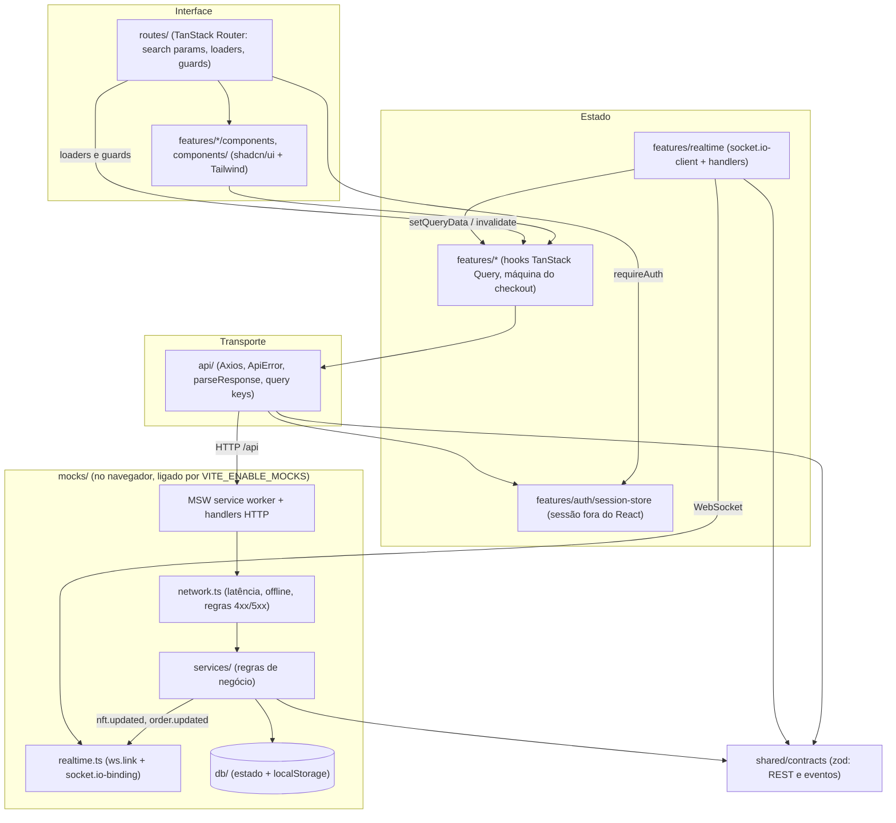
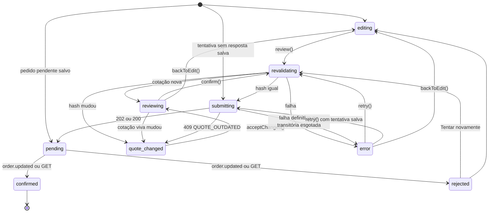

# Arquitetura — Kurio

Documento técnico da solução: camadas, contratos, políticas de sessão, carrinho, checkout, cache e tempo real, a camada de mocks, acessibilidade, performance, decisões de UX, desvios do Figma e limitações. Setup e comandos estão no [README](./README.md).

## Sumário

- [Visão geral](#visão-geral)
- [Decisões e trade-offs](#decisões-e-trade-offs)
- [Rotas da aplicação](#rotas-da-aplicação)
- [Contratos REST](#contratos-rest)
- [Eventos Socket.IO](#eventos-socketio)
- [Política de sessão](#política-de-sessão)
- [Estado do carrinho](#estado-do-carrinho)
- [Checkout](#checkout)
- [Cache, retries e sincronização (TanStack Query)](#cache-retries-e-sincronização-tanstack-query)
- [Reconciliação REST × Socket.IO](#reconciliação-rest--socketio)
- [Mocks](#mocks)
- [Acessibilidade](#acessibilidade)
- [Performance](#performance)
- [Decisões de UX](#decisões-de-ux)
- [Desvios do Figma](#desvios-do-figma)
- [Limitações conhecidas](#limitações-conhecidas)
- [Estrutura de pastas](#estrutura-de-pastas)

## Visão geral

A aplicação é uma SPA em camadas com dependência em um sentido só. Os contratos (schemas zod) são a única definição de formato e são importados tanto pelo cliente quanto pelos mocks. Componentes nunca chamam Axios nem conhecem respostas fictícias: consomem hooks do TanStack Query, que chamam funções tipadas da camada `api/`. Os mocks ficam inteiramente na camada de rede (service worker do MSW e interceptação de WebSocket), então o mesmo código de produção conversaria com um backend real que implementasse os contratos.



Fluxo de boot (`src/main.tsx`): com mocks ligados, importa `mocks/browser` e espera o worker do MSW assumir antes de qualquer requisição; enquanto isso, já baixa os chunks da rota inicial. Depois liga o ciclo de vida da sessão ao cache e ao router, dispara a validação do token salvo (sem bloquear o render das rotas públicas) e renderiza. O `RealtimeProvider` abre o socket só quando a sessão sai de `loading`.

## Decisões e trade-offs

| Decisão                                                                                        | Por quê                                                                                              | Custo                                                                                             |
| ---------------------------------------------------------------------------------------------- | ---------------------------------------------------------------------------------------------------- | ------------------------------------------------------------------------------------------------- |
| Contratos em zod compartilhados entre cliente e mocks; toda resposta passa por `parseResponse` | Um formato só; divergência vira `ApiError` tratável, não dado corrompido na tela                     | Validação em runtime em toda resposta (barata nos volumes do desafio)                             |
| Servidor simulado completo no navegador (MSW + banco em `localStorage`)                        | Build publicado sem backend, estado consistente entre REST e eventos, cenários reproduzíveis         | MSW e handlers rodam na thread principal: pesa no Lighthouse mobile ([Performance](#performance)) |
| Carrinho no servidor, inclusive do visitante (`X-Cart-Id`)                                     | Disponibilidade, cupom e cotação calculados num lugar só; merge no login sem lógica no cliente       | Toda edição do carrinho é uma ida ao servidor (sem otimismo no carrinho)                          |
| Cotação (`GET /api/cart/quote`) como fonte de verdade dos valores, com `hash`                  | Resumo exibido e pedido criado usam os mesmos números; mudança detectável por comparação             | Uma requisição extra por rede selecionada                                                         |
| Sessão em store externo (não em Context)                                                       | Interceptor do Axios, guards e socket leem o token de forma síncrona                                 | Assinatura manual via `useSyncExternalStore`                                                      |
| Socket único por sessão, recriado na troca de token                                            | Listeners, deduplicação e assinaturas pertencem a uma sessão; nada vaza para outro usuário           | Reconexão completa a cada login/logout                                                            |
| Atualização otimista só em favoritos                                                           | É a interação de maior frequência e menor risco; carrinho e pedido dependem de validação do servidor | Rollback e feedback precisam ser explícitos                                                       |
| Busca, filtros e paginação na URL com serialização plana (`?category=a&category=b`)            | Compartilhável, legível e no mesmo formato aceito pela API                                           | `parseSearch`/`stringifySearch` próprios em vez do JSON padrão do router                          |
| Mutations sem retry automático; pedido com estratégia própria (`Idempotency-Key`)              | Repetir uma escrita sem idempotência pode duplicar efeitos                                           | O usuário vê o erro e decide; só o pedido repete sozinho                                          |

## Rotas da aplicação

| Rota                                                | Arquivo                            | Acesso  | Observações                                                                                                                                                                                         |
| --------------------------------------------------- | ---------------------------------- | ------- | --------------------------------------------------------------------------------------------------------------------------------------------------------------------------------------------------- |
| `/`                                                 | `index.tsx`                        | público | Destaques + catálogo. `validateSearch` (`q`, `category[]`, `network[]`, `minPrice`, `maxPrice`, `tab`, `sort`, `page`), tolerante a valor inválido campo a campo. Loader faz prefetch sem bloquear. |
| `/nft/$nftId`                                       | `nft.$nftId.tsx`                   | público | Detalhe; `?edition=` guarda a edição escolhida. NFT inexistente mostra "NFT não encontrado".                                                                                                        |
| `/carrinho`                                         | `carrinho.tsx`                     | público | Visitante edita o carrinho; "Conectar e finalizar" leva a `/pagamento`.                                                                                                                             |
| `/pagamento`                                        | `pagamento.tsx`                    | privado | Dados do colecionador, carteira, rede, conexão simulada, cupom, revisão e envio.                                                                                                                    |
| `/pedido/$orderId`                                  | `pedido.$orderId.tsx`              | privado | Recibo só para `confirmed`; `pending` aguarda; `rejected` mostra a recusa; pedido de outra conta = "Pedido não encontrado".                                                                         |
| `/entrar`, `/cadastro`                              | `entrar.tsx`, `cadastro.tsx`       | público | `?redirect=` validado contra open redirect. Usuário já autenticado é redirecionado. Modal sobre a Início no desktop, tela cheia no mobile.                                                          |
| `/perfil`, `/perfil/carteiras`, `/perfil/favoritos` | `perfil*.tsx`                      | privado | Layout com navegação lateral; dados + avatar + senha, carteiras, lista de interesse.                                                                                                                |
| qualquer outra                                      | `__root.tsx` (`notFoundComponent`) | público | Página 404.                                                                                                                                                                                         |

Rotas privadas usam `beforeLoad: requireAuth`, que espera a validação do boot (`auth.whenReady()`) antes de decidir, para um refresh em `/perfil` não mandar um usuário logado ao login.

## Contratos REST

Base `VITE_API_URL` (padrão `/api`). Schemas em `src/shared/contracts/` (`account.ts`, `nft.ts`, `commerce.ts`, `common.ts`). Valores em ETH trafegam sempre como string decimal (`^\d+(\.\d{1,18})?$`); quantidades são inteiras.

Cabeçalhos:

- `Authorization: Bearer <token>`: rotas de conta; opcional nas de carrinho (sem token, vale o carrinho do visitante). Token inválido ou expirado é `401` mesmo onde a autenticação é opcional.
- `X-Cart-Id: <uuid>`: carrinho do visitante, enviado só quando não há sessão.
- `Idempotency-Key: <8 a 128 caracteres>`: obrigatório em `POST /api/orders`.

### Envelope de erro

Toda resposta de erro tem o mesmo corpo (`apiErrorBodySchema`):

```json
{
  "error": {
    "code": "AVAILABILITY_CONFLICT",
    "message": "Só restam 2 unidades disponíveis desta edição.",
    "fieldErrors": { "campo": "mensagem" },
    "details": { "available": 2, "inCart": 1 }
  }
}
```

`fieldErrors` e `details` são opcionais. No cliente, `api/errors.ts` normaliza qualquer falha do Axios em `ApiError { status, code, message, fieldErrors?, details?, isTransient }`; `status: 0` significa que não houve resposta HTTP. `applyFieldErrors` leva `fieldErrors` ao react-hook-form e foca o primeiro campo.

| HTTP         | Códigos                                                                                                                                                       |
| ------------ | ------------------------------------------------------------------------------------------------------------------------------------------------------------- |
| 401          | `UNAUTHENTICATED`, `SESSION_EXPIRED`, `INVALID_CREDENTIALS`                                                                                                   |
| 403          | `FORBIDDEN` (recurso de outra conta), `WALLET_REJECTED` (recusa na "extensão")                                                                                |
| 404          | `NOT_FOUND`                                                                                                                                                   |
| 409          | `CONFLICT`, `EMAIL_TAKEN`, `USERNAME_TAKEN`, `AVAILABILITY_CONFLICT`, `EDITION_UNAVAILABLE`, `QUOTE_OUTDATED`, `IDEMPOTENCY_CONFLICT`, `WALLET_NOT_CONNECTED` |
| 422          | `VALIDATION_ERROR`, `COUPON_INVALID`, `COUPON_EXPIRED`, `INVALID_PASSWORD`                                                                                    |
| 5xx          | `SERVICE_UNAVAILABLE` (503, falha transitória simulada), `INTERNAL_ERROR`                                                                                     |
| sem resposta | `NETWORK_ERROR`, `TIMEOUT` (só no cliente)                                                                                                                    |

São transitórios (`isTransient`) `NETWORK_ERROR`, `TIMEOUT` e qualquer status ≥ 500. Além dos erros de domínio abaixo, qualquer rota pode responder erro de rede ou 4xx/5xx conforme o perfil de rede do cenário ([Simulação de rede](#simulação-de-rede)).

### Rotas

| Método | Rota                               | Auth                       | Request                                                                                                                                                                                                                                   | Response                                                                                           | Erros de domínio                                                                                                                                                 |
| ------ | ---------------------------------- | -------------------------- | ----------------------------------------------------------------------------------------------------------------------------------------------------------------------------------------------------------------------------------------- | -------------------------------------------------------------------------------------------------- | ---------------------------------------------------------------------------------------------------------------------------------------------------------------- |
| POST   | `/auth/register`                   | —                          | `RegisterRequest { username, email, password }`                                                                                                                                                                                           | `201 Session { token, expiresAt, user }`                                                           | 422 `VALIDATION_ERROR`; 409 `EMAIL_TAKEN` / `USERNAME_TAKEN` (com `fieldErrors`)                                                                                 |
| POST   | `/auth/login`                      | —                          | `LoginRequest { email, password }`                                                                                                                                                                                                        | `200 Session`                                                                                      | 422; 401 `INVALID_CREDENTIALS`                                                                                                                                   |
| GET    | `/auth/session`                    | Bearer                     | —                                                                                                                                                                                                                                         | `200 SessionResponse { user, expiresAt }`                                                          | 401 `UNAUTHENTICATED` / `SESSION_EXPIRED`                                                                                                                        |
| POST   | `/auth/logout`                     | Bearer                     | —                                                                                                                                                                                                                                         | `204`                                                                                              | — (sem token também é 204)                                                                                                                                       |
| GET    | `/nfts`                            | —                          | `CatalogQuery` na query string: `q`, `category` e `network` repetidos, `minPrice`, `maxPrice`, `tab` (`todos`, `novos`, `em-alta`), `sort` (`recentes`, `menor-preco`, `maior-preco`, `populares`, `nome`), `page`, `pageSize` (padrão 9) | `200 CatalogResponse { items, pagination, facets { categories, networks, priceRange }, featured }` | —                                                                                                                                                                |
| GET    | `/nfts/:id`                        | —                          | —                                                                                                                                                                                                                                         | `200 NftDetailResponse { nft, related }`                                                           | 404 `NOT_FOUND`                                                                                                                                                  |
| GET    | `/me/favorites`                    | Bearer                     | —                                                                                                                                                                                                                                         | `200 { nftIds }`                                                                                   | 401                                                                                                                                                              |
| PUT    | `/me/favorites/:nftId`             | Bearer                     | —                                                                                                                                                                                                                                         | `204` (idempotente)                                                                                | 401; 404                                                                                                                                                         |
| DELETE | `/me/favorites/:nftId`             | Bearer                     | —                                                                                                                                                                                                                                         | `204` (idempotente)                                                                                | 401; 404                                                                                                                                                         |
| GET    | `/cart`                            | opcional + `X-Cart-Id`     | —                                                                                                                                                                                                                                         | `200 Cart` (cria vazio se não existir)                                                             | 401 com token inválido                                                                                                                                           |
| POST   | `/cart/items`                      | opcional                   | `AddCartItemRequest { nftId, editionId, quantity }`                                                                                                                                                                                       | `200 Cart`                                                                                         | 404; 409 `EDITION_UNAVAILABLE`; 409 `AVAILABILITY_CONFLICT` (`details { available, inCart }`); 422                                                               |
| PATCH  | `/cart/items/:itemId`              | opcional                   | `UpdateCartItemRequest { quantity }`                                                                                                                                                                                                      | `200 Cart` (também confirma o preço vigente)                                                       | 404; 409 `AVAILABILITY_CONFLICT`; 422                                                                                                                            |
| DELETE | `/cart/items/:itemId`              | opcional                   | —                                                                                                                                                                                                                                         | `200 Cart`                                                                                         | 404                                                                                                                                                              |
| POST   | `/cart/merge`                      | Bearer                     | `{ guestCartId }`                                                                                                                                                                                                                         | `200 Cart`                                                                                         | 401; 422                                                                                                                                                         |
| POST   | `/cart/coupon`                     | opcional                   | `ApplyCouponRequest { code }`                                                                                                                                                                                                             | `200 Cart`                                                                                         | 422 `COUPON_INVALID` / `COUPON_EXPIRED` (`fieldErrors.code`)                                                                                                     |
| DELETE | `/cart/coupon`                     | opcional                   | —                                                                                                                                                                                                                                         | `200 Cart`                                                                                         | —                                                                                                                                                                |
| GET    | `/cart/quote?network=`             | opcional                   | `network` (`ethereum` se ausente)                                                                                                                                                                                                         | `200 Quote`                                                                                        | 422 rede inválida                                                                                                                                                |
| POST   | `/orders`                          | Bearer + `Idempotency-Key` | `CreateOrderRequest { quoteId, quoteHash, walletId, network, collector }`                                                                                                                                                                 | `202 Order` (criado, `pending`) ou `200 Order` (mesma chave e mesmo corpo)                         | 401; 404 carteira; 409 `IDEMPOTENCY_CONFLICT`; 409 `WALLET_NOT_CONNECTED`; 409 `QUOTE_OUTDATED` (`details`: `Quote` atual); 409 `CONFLICT` (nada comprável); 422 |
| GET    | `/orders/:id`                      | Bearer                     | —                                                                                                                                                                                                                                         | `200 Order`                                                                                        | 401; 403 `FORBIDDEN`; 404                                                                                                                                        |
| GET    | `/me/orders?status=`               | Bearer                     | `status` opcional (`pending`, `confirmed`, `rejected`)                                                                                                                                                                                    | `200 { items: Order[] }`                                                                           | 401; 422                                                                                                                                                         |
| GET    | `/me/profile`                      | Bearer                     | —                                                                                                                                                                                                                                         | `200 Profile`                                                                                      | 401                                                                                                                                                              |
| PATCH  | `/me/profile`                      | Bearer                     | `UpdateProfileRequest { displayName, username, email, walletNickname, ensName, ensSuffix }`                                                                                                                                               | `200 Profile`                                                                                      | 422; 409 `EMAIL_TAKEN` / `USERNAME_TAKEN`                                                                                                                        |
| PUT    | `/me/avatar`                       | Bearer                     | `{ dataUrl }` (PNG, JPEG ou WebP em base64, até ~1 MB)                                                                                                                                                                                    | `200 Profile`                                                                                      | 422                                                                                                                                                              |
| DELETE | `/me/avatar`                       | Bearer                     | —                                                                                                                                                                                                                                         | `200 Profile`                                                                                      | —                                                                                                                                                                |
| POST   | `/me/password`                     | Bearer                     | `ChangePasswordRequest { currentPassword, newPassword }`                                                                                                                                                                                  | `204` (encerra as outras sessões da conta)                                                         | 422 `INVALID_PASSWORD` (`fieldErrors.currentPassword`); 422 `VALIDATION_ERROR`                                                                                   |
| GET    | `/me/wallets`                      | Bearer                     | —                                                                                                                                                                                                                                         | `200 WalletsResponse { primary, secondary }`                                                       | 401                                                                                                                                                              |
| PUT    | `/me/wallets/:slot`                | Bearer                     | `UpsertWalletRequest`: campos da carteira, ou `{ sameAsPrimary: true }` na secundária                                                                                                                                                     | `200 WalletsResponse`                                                                              | 404 slot inexistente; 422 (`fieldErrors`); 409 `CONFLICT` (secundária "igual à principal" sem principal)                                                         |
| POST   | `/me/wallets/:walletId/connection` | Bearer                     | `{ network }`                                                                                                                                                                                                                             | `200 WalletConnection { walletId, network, status, connectedAt }`                                  | 404; 403 `WALLET_REJECTED`; 422                                                                                                                                  |
| DELETE | `/me/wallets/:walletId/connection` | Bearer                     | —                                                                                                                                                                                                                                         | `204`                                                                                              | 401                                                                                                                                                              |

Regras de negócio relevantes do servidor simulado:

- **Cotação**: para cada item, `quantity = min(pedida, disponível)`; edição esgotada não é cobrada. `issues` descreve `price-changed` (preço vigente ≠ preço com que o item entrou), `quantity-reduced` e `sold-out`. Taxa de rede só entra se houver linha comprável. O `hash` cobre carrinho, rede, cupom, linhas (pedido, ajustado, disponível, preço), desconto e taxa: qualquer mudança que afete a cobrança muda o hash.
- **Pedido**: na ordem, confere idempotência (mesma chave + mesmo hash do corpo canônico devolve o pedido existente; corpo diferente é `IDEMPOTENCY_CONFLICT`), carteira conectada na mesma rede, aplica a "pegadinha" do cenário, recalcula a cotação e compara o hash, tira o snapshot dos itens e cria `pending`. A liquidação ocorre após `paymentDelayMs` (padrão 2,5 s): `confirmed` decrementa a disponibilidade (emitindo `nft.updated`), remove do carrinho só os itens e quantidades comprados e gera `transaction { hash, explorerUrl, confirmedAt }`; `rejected` não mexe no carrinho. Se faltar estoque na liquidação, o pedido é recusado. Estados terminais não mudam mais.
- **Cupons**: `KURIO10` (10%), `GENESIS` (0,05 ETH, limitado ao subtotal), `LANCAMENTO` (expirado). Códigos são normalizados para maiúsculas.

## Eventos Socket.IO

Schemas em `src/shared/contracts/realtime.ts`. Endpoint `VITE_SOCKET_URL`, transporte `websocket`, handshake com `auth: { token }` (visitante conecta sem token e recebe só eventos públicos).

Envelope comum:

```ts
{
  eventId: string                // estável: reenvio do mesmo fato chega com o mesmo id
  type: 'nft.updated' | 'order.updated'
  occurredAt: string             // ISO 8601
  resource: { type: 'nft' | 'order'; id: string; version: number } // versão monotônica do recurso
  data: { ... }
}
```

| Evento              | Direção            | Payload (`data`)                                                        | Entrega                                                                                                                                     |
| ------------------- | ------------------ | ----------------------------------------------------------------------- | ------------------------------------------------------------------------------------------------------------------------------------------- |
| `nft.updated`       | servidor → cliente | `{ nftId, priceEth, soldOut, editions: [{ id, priceEth, available }] }` | Todas as conexões. Emitido depois que a mudança foi gravada no banco (o REST já reflete o novo estado). `eventId = evt_nft_<id>_v<versão>`. |
| `order.updated`     | servidor → cliente | `{ orderId, userId, status, transactionHash, failureReason }`           | Só conexões cujo token pertence ao dono, conferido a cada envio. `eventId = evt_order_<id>_v<versão>`.                                      |
| `order.subscribe`   | cliente → servidor | `{ orderId }`                                                           | O servidor aceita só pedidos do dono do token e responde na hora com um `order.updated` do estado atual.                                    |
| `order.unsubscribe` | cliente → servidor | `{ orderId }`                                                           | Encerra a assinatura.                                                                                                                       |

Garantias que o cliente assume e verifica:

- `eventId` repetido é duplicata e é descartado (conjunto dos últimos 500 ids por sessão).
- `resource.version` menor ou igual à última conhecida (do evento anterior ou do cache REST) é evento antigo e é descartado; nada regride.
- Pedido terminal no cache não é alterado por evento nenhum.
- Payload fora do schema é ignorado.

## Política de sessão

- **Token**: opaco (`kt_<hex>`), emitido em login e cadastro, com `expiresAt`. TTL de 30 min no servidor simulado (20 s no cenário `session-expiring`). Senhas ficam no banco simulado só como SHA-256 com salt aleatório.
- **Persistência**: `{ token, expiresAt, user }` em `localStorage` (`kurio.session`), validado com zod na leitura. O estado vive em `features/auth/session-store.ts`, fora do React, porque o interceptor do Axios, os guards e o socket precisam dele de forma síncrona.
- **Boot**: com sessão salva, o estado começa em `loading` e `GET /auth/session` decide. `SESSION_EXPIRED` encerra guardando o motivo e o endereço atual; `UNAUTHENTICATED` limpa; falha transitória mantém o usuário salvo (o próximo 401 encerra). Rotas públicas renderizam já; guards esperam `whenReady()`.
- **Expiração durante a navegação**: um timer consulta `GET /auth/session` 1 s depois de `expiresAt` (quem decide é o servidor, o relógio só escolhe quando perguntar). Além disso, qualquer `401 SESSION_EXPIRED`/`UNAUTHENTICATED` numa chamada autenticada expira a sessão, desde que o `Authorization` enviado seja o token atual (resposta atrasada de uma sessão anterior não derruba a nova). Ao expirar, `bindSessionLifecycle` limpa o cache privado e chama `router.invalidate()`: em rota privada o guard redireciona para `/entrar?redirect=<href atual>` com o motivo na tela; em rota pública aparece a faixa "Sua sessão expirou…" com "Entrar novamente". Depois do login a navegação segue para `redirect`, ou o `resumeHref` guardado, ou `/`.
- **Expiração durante o checkout**: o formulário de pagamento grava um rascunho a cada mudança em `sessionStorage` (`kurio.checkoutDraft.<userId>`), usado como valor inicial ao voltar. Uma tentativa de pedido sem resposta definitiva (`kurio.checkoutAttempt.<userId>`) e o pedido pendente (`kurio.pendingOrder.<userId>`, `localStorage`) também são por usuário: o mesmo usuário retoma; outro não vê.
- **Logout e troca de usuário**: `POST /auth/logout` e limpeza local mesmo se o servidor não responder. Sempre que o `user.id` muda (logout, expiração, outro login, login em outra aba via evento `storage`), as queries privadas (`['me']`, `['cart']`, `['order']`) são canceladas e removidas e o cache de mutations é limpo. O `RealtimeProvider` fecha o socket da sessão anterior (remove listeners e assinaturas) e abre outro com o novo token. Conexão de carteira, rascunho e pedido pendente são lidos por usuário.
- **Guards**: `requireAuth` em `/pagamento`, `/pedido/$orderId` e `/perfil/*`. `/entrar` e `/cadastro` mandam quem já está logado para o destino. O `redirect` só aceita caminho relativo do próprio app (bloqueia `//host`, `/\host`, URLs absolutas, caracteres de controle e loop para o próprio login).
- **Troca de senha** encerra as outras sessões da conta; a atual continua.

## Estado do carrinho

- **Servidor como fonte**: o cliente não calcula o carrinho. Cada mutation (`POST/PATCH/DELETE /cart/items`, cupom) devolve o `Cart` inteiro, gravado no cache do dono que disparou a ação. Respostas concorrentes que chegam fora de ordem são resolvidas por `cart.version` (a mais nova vence); se a sessão mudou no meio, a resposta é descartada.
- **Visitante**: `X-Cart-Id` é um UUID gerado no cliente e salvo em `localStorage` (`kurio.guestCartId`). O carrinho sobrevive a refresh porque está no banco simulado.
- **Merge no login/cadastro**: `POST /cart/merge { guestCartId }` soma as quantidades do visitante às da conta, limitadas à disponibilidade, leva o cupom se a conta não tinha e apaga o carrinho de visitante. O id local é descartado depois do merge (logout começa com carrinho novo). Se o merge falhar, o id fica e o merge é tentado de novo no próximo boot autenticado.
- **Mudanças via socket**: `nft.updated` atualiza preço e disponibilidade das linhas afetadas em todos os carrinhos em cache, invalida carrinho e cotações e, para o dono atual, gera avisos (`price-increased`, `price-decreased`, `availability-reduced`, `sold-out`, `back-in-stock`) anunciados no `aria-live` assertivo. Os avisos ficam até serem dispensados e só aparecem para itens ainda no carrinho. "Aceitar novo preço" é um `PATCH` com a mesma quantidade, que confirma o preço vigente (`addedUnitPriceEth`).
- **Valores**: subtotal, desconto, taxa e total exibidos vêm da cotação (`GET /cart/quote`), nunca de soma no cliente. Item esgotado continua no carrinho, marcado como "Não será cobrado".
- **Precisão decimal**: ETH é string em todo o caminho (contrato, cache, formulário). Contas usam `shared/lib/money.ts` sobre decimal.js-light (precisão 40, `ROUND_HALF_UP`, 18 casas); `mulEth` rejeita quantidade não inteira. `formatEth` só formata para exibição (ex.: `1.19 ETH`, `0.016 ETH`) e há leitura própria para leitor de tela ("1,19 ether").

## Checkout

Implementado em `features/checkout/use-checkout.ts` como um reducer com fases explícitas; `pending → confirmed/rejected` é derivado do estado do pedido no cache.



(`quote_changed` é a fase `quote-changed` do código.)

- **Validação e revisão**: o formulário valida com o mesmo `collectorInfoSchema` do contrato. "Confirmar compra" no formulário exige carteira escolhida e conectada na rede; então `review()` busca uma cotação nova (`staleTime: 0`) e abre o diálogo "Revise sua compra" com itens, valores, `issues`, dados e carteira.
- **Revalidação**: durante a revisão, a cotação fica observada; um `nft.updated` invalida a query e, se o `hash` mudar, a fase vira `quote-changed` e o botão de confirmar é trocado por "Aceitar novos valores" (com tabela antes/agora). Ao confirmar, a cotação é buscada de novo; hash diferente da revisada também exige nova aceitação. O servidor confere o hash outra vez e responde `409 QUOTE_OUTDATED` com a cotação atual, aplicada no cache e mostrada como mudança.
- **Idempotência por tentativa**: cada confirmação cria uma tentativa `{ key: uuid, body }` gravada em `sessionStorage` antes do primeiro `POST`. Enquanto não houver resposta definitiva, qualquer reenvio usa a mesma chave e o mesmo corpo. Erro definitivo (4xx) descarta a tentativa; erro transitório a mantém.
- **Timeout**: o `POST /orders` tem timeout de 8 s. Falha transitória é repetida automaticamente até 3 envios no total, com backoff exponencial e jitter, sempre com a mesma chave; o servidor devolve o pedido já criado (`200`). Esgotadas as tentativas, a fase vira `error` e "Tentar novamente" reenvia a mesma tentativa antes de qualquer outra coisa. Refresh no meio retoma em `submitting` com a tentativa salva.
- **Duplo clique**: `inFlight` (ref) bloqueia chamadas concorrentes, o botão entra em carregamento, `canConfirm` só é verdadeiro em `reviewing` com linha comprável e o diálogo não fecha durante `revalidating`, `submitting` e `pending`.
- **Pedido pendente e retomada**: o id do pedido criado vai para `localStorage` por usuário. `useOrder` assina `order.subscribe` enquanto o pedido estiver pendente e faz polling de 4 s como fallback (inclusive com a aba em segundo plano). Após refresh, o checkout abre direto em `pending` com esse pedido; após reconexão, o servidor reenvia o estado atual na assinatura e o cliente reconcilia com o REST. O id salvo é apagado quando o pedido chega a um estado terminal. Se o servidor não reconhece o pedido salvo (404/403, ex.: banco resetado), o checkout mostra o erro, descarta o id salvo e "Voltar e editar" retorna ao formulário.
- **Terminalidade**: o `structuralSharing` da query de pedido nunca troca um pedido terminal por um não terminal nem uma versão maior por uma menor; o handler do socket ignora eventos de pedido terminal; o servidor ignora liquidações de pedido não pendente.
- **Confirmação e recibo**: `confirmed` navega para `/pedido/$orderId` (com `replace`). A confirmação vinda do socket só invalida a query; o recibo aparece quando o snapshot REST completo (hash da transação, link, horário) chega. O recibo usa só os campos do `Order` (itens, preços unitários, subtotal, desconto, taxa, total, carteira, rede), congelados na criação: mudanças posteriores de catálogo não o alteram. Após a confirmação, carrinho, catálogo e detalhes são invalidados; o servidor já removeu apenas o que foi comprado.
- **Recusa**: "Pagamento recusado" com o motivo; itens preservados; "Tentar novamente" revalida e volta à revisão (nova tentativa, nova chave).

## Cache, retries e sincronização (TanStack Query)

Configuração em `src/app/query-client.ts`; chaves em `src/api/query-keys.ts`.

| Recurso                      | Query key                                               | `staleTime` | Foco na janela | Observações                                                       |
| ---------------------------- | ------------------------------------------------------- | ----------- | -------------- | ----------------------------------------------------------------- |
| Catálogo                     | `['catalog', query]`                                    | 30 s        | não            | `keepPreviousData`; o socket mantém preço/estoque entre refetches |
| Detalhe                      | `['nft', id]`                                           | 30 s        | não            | prefetch no loader e por intenção (hover)                         |
| Favoritos, perfil, carteiras | `['me', userId, 'favorites' \| 'profile' \| 'wallets']` | 15 s        | sim            | podem mudar em outra aba                                          |
| Carrinho                     | `['cart', 'user:<id>' \| 'guest:<cartId>']`             | 5 s         | sim            |                                                                   |
| Cotação                      | `['cart', owner, 'quote', network]`                     | 5 s         | sim            | `keepPreviousData` no resumo; `staleTime: 0` na revisão           |
| Pedido                       | `['order', id]`                                         | 0           | —              | polling de 4 s enquanto `pending`                                 |

- **Retry**: queries repetem até 2 vezes, só em erro transitório (rede, timeout, 5xx), com backoff exponencial de base 1 s, teto 8 s e jitter. 4xx nunca repete. Mutations não repetem (`retry: false`); a criação de pedido tem a estratégia própria descrita no checkout. `gcTime` de 5 min.
- **Isolamento por usuário e parâmetros**: dados públicos são chaveados por todos os parâmetros da consulta; dados privados carregam o dono na chave (`userId` ou `guest:<cartId>`). Na troca de usuário as raízes privadas são removidas e as mutations esquecidas. Mutations guardam o dono em `onMutate` e descartam a resposta se o dono mudou.
- **Cancelamento e respostas obsoletas**: todo `queryFn` repassa o `AbortSignal` ao Axios. Ao trocar de filtro, a requisição da chave antiga é abortada quando perde os observadores e, se terminar mesmo assim, cai na chave dela, sem sobrescrever a lista atual. No socket, `reconcile` usa `cancelRefetch: false` para não abortar o carregamento inicial.
- **Atualização em segundo plano**: `keepPreviousData` no catálogo e na cotação mantém o conteúdo anterior esmaecido (`isPlaceholderData`/`isFetching`) em vez de voltar ao skeleton.
- **Atualização otimista com rollback (favoritos)**: `onMutate` cancela a query e aplica a mudança; em erro, o rollback desfaz só o item que falhou (não restaura um snapshot inteiro, para não apagar outro favorito alterado em paralelo), anuncia no `aria-live` assertivo e um único ouvinte no layout mostra o toast "O estado anterior foi restaurado". A invalidação só acontece quando a última mutation de favoritos termina; um novo clique no mesmo NFT é ignorado enquanto o anterior está em voo.
- **Invalidação após mutations**: carrinho grava a resposta e invalida as cotações do dono; conflito de disponibilidade invalida carrinho e detalhe. Perfil e carteiras gravam a resposta no cache e espelham nome/avatar na sessão. Pedido confirmado invalida carrinho, catálogo e detalhes.
- **Invalidação após eventos**: veja a próxima seção.

## Reconciliação REST × Socket.IO

`features/realtime/client.ts` (conexão) e `handlers.ts` (aplicação no cache).

- **Um socket por sessão**: aberto pelo `RealtimeProvider` quando a sessão é conhecida e recriado quando o token muda. Os handlers (deduplicação, versões) são criados por socket e conhecem o `userId` da sessão que os criou.
- **`nft.updated`**: descartado se o `eventId` já foi visto ou se a versão não é maior que a conhecida (maior entre a do último evento e a do detalhe em cache). Aplica preço/disponibilidade no detalhe (e nos relacionados), em todas as listas do catálogo em cache (que ficam marcadas como obsoletas para o próximo acesso, porque o preço novo pode tirar o item de um filtro) e nos carrinhos, que são invalidados junto com as cotações. Cada resumo também compara a própria `version` antes de aplicar.
- **`order.updated`**: ignorado se o `userId` do evento não é o da sessão do socket nem o da sessão atual; depois dedup, versão e terminalidade. Recusa é aplicada direto; confirmação só invalida (o recibo vem do REST).
- **Reconexão**: no `connect` (inclusive o primeiro), o cliente reenvia `order.subscribe` dos pedidos assinados e invalida catálogo, detalhes, carrinhos e pedidos não confirmados, porque eventos podem ter sido perdidos durante a queda. A reconexão automática do Socket.IO usa 1 s a 5 s com fator aleatório 0,5, e o handshake tem timeout de 6 s (o padrão de 20 s deixava o usuário tempo demais com dados possivelmente defasados quando a conexão fica pendurada). Quando o servidor encerra a conexão ou recusa o handshake, a reconexão automática do cliente para; nesse caso há um reagendamento manual com backoff exponencial e jitter, e o evento `online` do navegador força nova tentativa. Após 3 tentativas sem sucesso o status passa de `reconnecting` a `disconnected`.
- **Liberação**: `subscribeToOrder` conta referências e envia `order.unsubscribe` quando o último interessado sai; ao encerrar a sessão o socket faz `off()` de todos os listeners, `disconnect()` e remove o ouvinte de `online`.
- **Status do tempo real**: quando uma conexão já estabelecida cai por mais de 1,5 s, um aviso discreto (`RealtimeStatusPill`, `role="status"`) informa que as atualizações estão pausadas; some na reconexão, que reconcilia os dados com o REST.

## Mocks

### Arquitetura

```
mocks/
  browser.ts        sobe o banco, o worker (onUnhandledRequest: 'bypass') e expõe window.__kurio
  handlers/         rotas HTTP; route() aplica a simulação de rede e converte erros no envelope
  services/         regras de negócio (catálogo, carrinho, cotação, cupons, pedidos, pagamentos, conta)
  db/               schema zod do banco, seed determinístico e store com persistência
  realtime.ts       servidor Socket.IO simulado
  network.ts        latência, offline e regras por rota
  scenarios.ts      definição dos cenários
  runtime.ts        cenário e rede ativos (persistidos)
  control.ts        API de controle (window.__kurio)
  devtools/         painel "Simulação" (root React separado, carregado no idle)
  fixtures.ts       referências estáveis do seed para os testes
```

- **Banco**: um objeto `DbState` validado por zod (NFTs, usuários, sessões, favoritos, carrinhos, carteiras, conexões, pedidos, registros de idempotência, flags). Toda escrita passa por `db.mutate`, que grava o estado em `localStorage` (`kurio:mock-db:v1`). IDs sequenciais (`ord_00001`, `ci_00002`) deixam pedidos e itens previsíveis.
- **Consistência**: mudanças "do servidor" (painel, testes, liquidação de pagamento, pegadinhas do checkout) passam por `applyNftChange`, que grava no banco, incrementa a versão e só então emite `nft.updated`. REST e eventos sempre refletem o mesmo estado.
- **Persistência e reset**: no boot, o banco salvo é reaproveitado se for do mesmo tipo de seed (`full` ou `empty-catalog`); senão é recriado. Sessões vencidas há mais de 24 h são descartadas. `reset()` recria o seed, cancela timers de pagamento, limpa o histórico de eventos, retoma e derruba os sockets. Pagamentos pendentes são reagendados após refresh (`resumePendingPayments`).
- **Cenários determinísticos**: seed gerado por PRNG com semente fixa (60 NFTs, 2 usuários, carteiras e favoritos). Cada cenário define seed, rede, TTL de sessão, desfecho e atraso do pagamento, "pegadinha" do checkout, recusa única de carteira e atraso da resposta do pedido. Pegadinhas de uso único usam flags no banco, restauradas no reset. Cenário e rede ativos ficam em `kurio:mock-runtime:v1`; precedência `?scenario=` > salvo > `VITE_MOCK_SCENARIO`.

### Simulação de rede

`simulateNetwork` roda antes de todo handler REST:

- **Latência** por perfil: `none` 0, `fast` 30–90 ms, `slow` 1,5–2,5 s, `variable` 80–1600 ms. A latência de cada chamada vem de um PRNG semeado por método + URL + número da chamada: a mesma sequência de requisições repete as mesmas latências, o que torna respostas fora de ordem reproduzíveis.
- **Offline**: `HttpResponse.error()` (erro de rede no Axios) e o servidor de tempo real recusa conexões.
- **Regras** (`NetworkRule`): por método e caminho (`:param` e `*`), com efeito `status` (4xx/5xx com código do envelope), `offline` ou `delay`, limitadas por `times` (globais ou por URL com `perUrl`). Os contadores zeram a cada mudança de configuração.

### Transporte Socket.IO e limitações

O servidor de tempo real usa `ws.link(VITE_SOCKET_URL)` do MSW com `@mswjs/socket.io-binding`, que fala o protocolo Engine.IO/Socket.IO sobre o WebSocket interceptado. O cliente é o `socket.io-client` real; nenhum cenário chama setters ou o cache diretamente. Limitações deste transporte:

- **Só `websocket`**: long-polling HTTP não é interceptado, então o cliente usa `transports: ['websocket']`.
- **Sem rooms, namespaces nem acks** no binding. O roteamento por usuário é feito no próprio `realtime.ts`, com um registro das conexões e filtro pelo dono do token; as assinaturas de pedido ficam em um `Set` por conexão.
- **Heartbeat manual**: o binding não envia ping; `realtime.ts` emite o ping do Engine.IO a cada 25 s para o cliente não cair por "ping timeout".
- **Autenticação conferida por envio**: o binding responde o handshake (com sid fixo) antes de o `auth` ser conhecido, então um token inválido não recusa a conexão. O token é lido do pacote `CONNECT` e, a cada `order.updated`, o servidor confere se ele ainda pertence ao dono; após logout ou expiração, a conexão antiga deixa de receber eventos privados.
- **Import tardio do `socket.io-client`**: o cliente guarda o construtor de `WebSocket` quando o módulo é avaliado. Ele é importado dinamicamente dentro de `startRealtime`, que só roda depois de `startMocks()`; importado antes, a conexão escaparia da interceptação. O import tardio também tira o Socket.IO do bundle inicial.
- **Eventos só na aba que gerou a mudança**: cada aba roda sua própria instância do servidor simulado.

### Alias `tldts` → `tldts-lite`

O MSW usa o tough-cookie para guardar cookies de `Set-Cookie` mockados, e o tough-cookie usa o `tldts` só para descobrir o domínio registrável de um host. A lista pública de sufixos embutida no `tldts` pesava ~110 KB gzip, mais que o restante do MSW, e estava no caminho crítico do build de demonstração. Nenhum handler emite cookie (a sessão é por token), então `src/mocks/lib/tldts-lite.ts` implementa a regra simplificada (dois últimos rótulos; IP e host de um rótulo não têm domínio) e o `vite.config.ts` aponta `tldts` para ele. Resultado: o chunk `mocks-vendor` caiu de 166 KB para 53 KB gzip.

## Acessibilidade

- **Teclado e foco**: skip link "Pular para o conteúdo" para `#conteudo`; foco visível em todos os controles (`outline` na cor de destaque); ordem de tabulação igual à de leitura (o escalonamento da grade mobile é só visual). Menu da conta operável por setas.
- **Diálogos e drawers**: Radix prende o foco; `useReturnFocus` (em `dialog.tsx` e `sheet.tsx`) devolve o foco ao elemento que abriu, inclusive em diálogos abertos por estado (login como rota, revisão do pedido, filtros mobile), que o Radix sozinho não cobre. Mudança de fase no checkout e no pedido move o foco para o novo título.
- **Formulários**: label em todo campo, `aria-invalid` e `aria-describedby` para a mensagem de erro, foco no primeiro erro (inclusive erros vindos da API). Botões `type="submit"` não roubam o foco no `mousedown`, para que a validação `onTouched` não desloque o botão entre o pressionar e o soltar.
- **Feedback acessível**: regiões `aria-live` fixas no layout (`status` polido e `alert` assertivo) desde o primeiro render. Mutations anunciam sucesso; falhas de favoritos e mudanças em tempo real no carrinho são assertivas. Toasts são só o complemento visual.
- **Semântica e textos alternativos**: `alt` das artes vem do contrato (`imageAlt`); decorações ficam fora da árvore de acessibilidade. Preços têm rótulo próprio para leitor de tela ("1,19 ether"). Estados não dependem só de cor: esgotado, raro, preço alterado e itens "Em breve" têm texto. Itens fora do escopo usam tooltip "Em breve" e texto oculto "(em breve)".
- **Movimento e layout**: shimmer e transições desligados com `prefers-reduced-motion`. Skeletons com as dimensões do conteúdo (CLS 0 nas auditorias). O layout é fluido de 320 a 1440 px, sem largura fixa maior que a viewport, para não gerar rolagem horizontal nem perder conteúdo com zoom de 200%. Os testes E2E e as baselines visuais cobrem 1440 px e 412 px; não há teste automatizado dedicado a overflow. No limite de quantidade o stepper usa `aria-disabled` em vez de `disabled`, para o foco não cair no `body`.
- **Ajuste em relação ao layout**: a borda de campo do Figma (`#3F2319`) fica em 1,3:1 sobre o fundo. Inputs, selects e textareas usam `#8A6040` (`--color-field-border`) para atingir 3:1 (WCAG 1.4.11). Os campos sem rótulo visível no Figma têm rótulo acessível.
- **Lighthouse Accessibility**: 100 em três dos quatro casos e 96 no detalhe mobile. O único item é `target-size`: na rolagem inicial, o botão flutuante "Simulação" (painel de demonstração) fica sobre o botão "−" de quantidade.

## Performance

Resultado final (`lighthouse-reports/latest/summary.md`, mediana de 3 execuções, Lighthouse 13.6.0, Chrome for Testing 153, build de produção servido por `vite preview` com Brotli, mocks ligados, cenário `default`, visita fria):

| Página  | Perfil  | Perf   | A11y | BP  | SEO | LCP     | CLS   | TBT    | FCP    | SI      |
| ------- | ------- | ------ | ---- | --- | --- | ------- | ----- | ------ | ------ | ------- |
| Início  | Mobile  | **68** | 100  | 100 | 100 | 3884 ms | 0.000 | 871 ms | 778 ms | 1437 ms |
| Início  | Desktop | 99     | 100  | 100 | 100 | 843 ms  | 0.000 | 44 ms  | 232 ms | 619 ms  |
| Detalhe | Mobile  | **73** | 96   | 100 | 100 | 3530 ms | 0.000 | 716 ms | 767 ms | 1799 ms |
| Detalhe | Desktop | 99     | 100  | 100 | 100 | 856 ms  | 0.000 | 33 ms  | 224 ms | 580 ms  |

Condições: mobile com throttling simulado (RTT 150 ms, 1,6 Mbps, CPU 4x, 412×823 @1,75x); desktop com RTT 40 ms, 10 Mbps, CPU 1x, 1350×940. Máquina: Intel Xeon 2,10 GHz, 2 vCPUs, 8 GB, Node 22.23.4; benchmarkIndex mediano 1861; carga média ~2 no início da rodada. Desktop bate todas as metas; mobile bate Accessibility, Best Practices e SEO.

Evolução em relação à linha de base (`lighthouse-reports/baseline/`, mesmo código sem as otimizações):

| Página/perfil   | Performance | LCP            | TBT           | CLS       |
| --------------- | ----------- | -------------- | ------------- | --------- |
| Início mobile   | 47 → 68     | 6091 → 3884 ms | 2792 → 871 ms | 0 → 0     |
| Início desktop  | 53 → 99     | 2749 → 843 ms  | 744 → 44 ms   | 0 → 0     |
| Detalhe mobile  | 47 → 73     | 5767 → 3530 ms | 3810 → 716 ms | 0 → 0     |
| Detalhe desktop | 74 → 99     | 2110 → 856 ms  | 309 → 33 ms   | 0.085 → 0 |

O que foi otimizado:

1. **Assets fora dos handlers do MSW**: o worker repassa à página toda requisição (chunks, fontes, imagens), e cada uma percorria ~30 handlers que leem `document.cookie`. Um `http.all` no topo faz `passthrough()` de tudo que não é `/api/`. Na Início mobile, o tempo de script do chunk do MSW caiu de 3,0 s para 0,9 s.
2. **Alias `tldts-lite`** (seção [Mocks](#alias-tldts--tldts-lite)): `mocks-vendor` de 166 KB para 53 KB gzip.
3. **Brotli no `vite preview`** (plugin `kurio:preview-brotli`), para medir o que a Vercel entrega.
4. **Hints de carregamento** (plugin `kurio:critical-preloads`, `index.html`, `main.tsx`): `modulepreload` dos chunks do MSW, chunks da rota inicial baixados em paralelo ao boot do worker, `preload` das fontes 400/700 e da arte do hero (`fetchpriority=high`, só em `/`).
5. **Montagem diferida abaixo da dobra** (`components/common/DeferredRender.tsx`): vitrines e blog da Início e o rodapé montam no idle ou quando se aproximam da tela (margem de 600 px), com placeholder de altura fixa. Tirou centenas de ms de bloqueio da thread principal no mobile sem mudança visual.
6. **CLS do detalhe desktop**: o skeleton era mais baixo que a página e empurrava o rodapé; `min-h-dvh` no skeleton desktop zerou o CLS.

Testados e descartados por piorar ou não mudar o resultado em A/B: renderizar antes do MSW com um "portão de rede" (LCP mobile pior, porque o render disputa CPU com o boot do worker) e `startTransition` no render inicial.

Por que Performance mobile fica abaixo de 90:

- **O backend roda no cliente.** Antes do primeiro dado, o navegador baixa e avalia o MSW, monta o banco simulado (seed + `localStorage`), registra o service worker e troca mensagens worker↔página a cada requisição; filtros, ordenação e serialização do banco rodam na thread principal. Com CPU 4x isso vira centenas de ms de long tasks. Em produção esse trabalho seria do servidor, mas o enunciado exige os mocks no build auditado e proíbe simplificações para a auditoria.
- **O LCP mobile depende da API.** O maior elemento é a imagem do primeiro card do catálogo (Início) e a arte do NFT (detalhe). A cadeia é JS da app + MSW → worker ativo → `/api/nfts` → render → imagem, e a rede simulada de 1,6 Mbps precisa de ~330 KB de JS antes disso. A arte do detalhe depende do id vindo da rota e dos dados, então não dá para pré-carregá-la no HTML.
- **CPU da máquina de auditoria.** São 2 vCPUs compartilhadas (carga média ~2 durante a rodada), e o Lighthouse multiplica as tarefas observadas por 4. A variação entre rodadas acompanha a carga: execuções individuais da Início mobile foram de 63 a 69 nesta rodada, e de 46 a 59 numa rodada anterior sob mais carga. O script aceita `--cpu-multiplier` para uma análise calibrada, mas o resultado reportado é o padrão do Lighthouse.

Próximos passos possíveis: evitar o refetch do primeiro `connect` do socket (o `reconcile` refaz requisições que acabaram de ser feitas), agrupar handlers para reduzir o custo por requisição de API e trocar a persistência do banco simulado por algo incremental.

## Decisões de UX

- **URL como estado do catálogo**: busca ao vivo com debounce de 300 ms e `replace` (digitar não enche o histórico); filtros, abas, ordenação e página entram no histórico; qualquer mudança de filtro volta para a página 1. URL editada à mão com valor inválido descarta só o campo inválido.
- **Troca de filtro sem tela vazia**: a grade anterior fica esmaecida até a nova chegar; skeleton só no primeiro carregamento. Resultado vazio oferece "Limpar filtros".
- **Contadores de filtro** calculados com os demais filtros aplicados (cada dimensão ignora a si mesma), para o usuário saber o que vai encontrar antes de clicar.
- **Detalhe**: "Comprar" adiciona e leva ao carrinho; o atalho de carrinho só adiciona e mostra toast com "Ver carrinho". Limite de quantidade explicado em texto (ex.: "Você já tem as 2 unidades disponíveis desta edição no carrinho").
- **Visitante** monta o carrinho sem login; checkout, favoritos e perfil levam ao login com retorno ao ponto de origem.
- **Remoção no carrinho** imediata com "Desfazer" no toast, em vez de diálogo de confirmação.
- **Mudanças de preço/estoque** nunca são silenciosas: aviso no carrinho, aceitação explícita do novo preço e, no checkout, tabela antes/agora com "Aceitar novos valores".
- **Revisão antes do envio** em diálogo que não fecha enquanto o pedido está sendo enviado ou pendente. No pendente, o texto informa que é seguro sair e oferece "Acompanhar pedido".
- **Falhas com saída**: todo erro de carregamento tem "Tentar novamente" e mantém o contexto (filtros, formulário, carrinho).
- **Fora do escopo** (Criadores, Aprenda, Atividade, Ofertas, Arquivos baixados, Suporte, "Ler mais" do blog, redes sociais, links do rodapé): desabilitados com "Em breve". Login social, recuperação de senha e o botão de QR code do mobile mostram toast informando que estão indisponíveis na demonstração. Nada aparenta sucesso. O link "Ver no Etherscan/Polygonscan/Solscan" do recibo aponta para um explorador fictício (`explorer.kurio.test`), indicado no `title`.

## Desvios do Figma

| Onde                                                  | Figma                                                                          | Implementado                                                                                                                                          | Motivo                                                                                |
| ----------------------------------------------------- | ------------------------------------------------------------------------------ | ----------------------------------------------------------------------------------------------------------------------------------------------------- | ------------------------------------------------------------------------------------- |
| Filtros (sidebar)                                     | Contadores fixos                                                               | Contadores reais da API (`facets`)                                                                                                                    | Coerência com o catálogo filtrado                                                     |
| Galeria do detalhe                                    | Quatro miniaturas                                                              | Miniaturas são enquadramentos da mesma arte (inteira, rosto, acessórios, centro)                                                                      | A API tem uma imagem por NFT; recortes dão sentido à troca da principal               |
| Card "NFT em destaque"                                | Imagem e "Oferta limitada"                                                     | Também nome (link) e preço                                                                                                                            | Destaque navegável e com informação de compra                                         |
| Filtros abaixo de 1024 px                             | Sidebar (desktop) / tela mobile                                                | Gaveta (sheet) lateral no tablet e inferior no mobile                                                                                                 | Sidebar de 270 px não cabe entre 768 e 1023 px                                        |
| Rodapé no mobile                                      | Não desenhado                                                                  | Sai nas telas com barra de ação própria ou tela cheia (detalhe, carrinho, pagamento, login, cadastro); nas demais aparece em versão empilhada         | Manter navegação secundária onde não há barra fixa                                    |
| Stepper de quantidade                                 | Variações de −/+ entre detalhe e carrinho                                      | Componente único (`QuantityStepper`): laranja no desktop e no detalhe mobile, círculo escuro no carrinho mobile                                       | Um padrão por contexto, com limite explicado em texto                                 |
| Slider de preço                                       | Trilha única                                                                   | Trilha fora da seleção mais apagada                                                                                                                   | Leitura da faixa selecionada                                                          |
| "Usar outra carteira?" e "Igual à carteira principal" | Rádio                                                                          | Checkbox com visual de anel de rádio                                                                                                                  | Rádio sozinho não pode ser desmarcado; a semântica correta é checkbox                 |
| Pagamento desktop                                     | "Carteira e rede" como lista de provedores (MetaMask, WalletConnect, Coinbase) | Lista das carteiras cadastradas no perfil (cards de rádio) e painel de conexão (conectar, recusa, desconectar)                                        | O enunciado pede usar as carteiras cadastradas e simular conexão, recusa e desconexão |
| Pagamento mobile                                      | Formulário corrido                                                             | "Perfil do colecionador" e "Resumo do pedido" em seções recolhíveis; abrem sozinhas quando há erro                                                    | Tela longa demais no mobile                                                           |
| Perfil e carteiras abaixo de 1024 px                  | Sem frame mobile                                                               | Sidebar vira faixa rolável no topo, só com destinos disponíveis                                                                                       | Perfil precisa funcionar em mobile                                                    |
| Recibo mobile                                         | Sem frame mobile                                                               | Coluna "Edições" vira linha "Edições: x N" sob o nome                                                                                                 | Tabela de 4 colunas não cabe em 390 px                                                |
| Bordas de campos                                      | `#3F2319`                                                                      | `#8A6040`                                                                                                                                             | Contraste 3:1 ([Acessibilidade](#acessibilidade))                                     |
| Artes                                                 | Assets do arquivo                                                              | Capturadas do Figma e exportadas em WebP 800 e 400 px (`public/art/{emerald,sage,ivory,golden}-{800,400}.webp`), reaproveitadas pelos 60 NFTs do seed | Só quatro artes no arquivo; `srcset` para o tamanho certo por tela                    |
| Itens fora do escopo                                  | Links ativos                                                                   | "Em breve" desabilitado com tooltip                                                                                                                   | O enunciado pede que não aparentem sucesso                                            |

## Limitações conhecidas

- **Performance mobile** abaixo de 90 (68 e 73), pelos motivos acima.
- **Socket.IO simulado**: só WebSocket, sem rooms/namespaces/acks, heartbeat manual e token inválido aceito como visitante (ver [limitações do transporte](#transporte-socketio-e-limitações)).
- **Banco por navegador e por aba**: o estado simulado vive no `localStorage` do navegador; não há compartilhamento entre dispositivos. Duas abas abertas mantêm cópias próprias em memória e a última escrita vence; eventos em tempo real só chegam à aba onde a mudança aconteceu.
- **Pagamentos usam timers da página**: com a aba fechada, a liquidação acontece no próximo boot.
- **Segurança da demonstração**: o token fica em `localStorage` (exposto a XSS); com backend real o caminho seria cookie `httpOnly`. SHA-256 com salt protege contra senha em claro no storage, mas não substitui um KDF (bcrypt/argon2) no servidor.
- **Conexão de carteira** não tem `GET` na API; a última conexão confirmada fica no `sessionStorage` da aba. Se o servidor responder `WALLET_NOT_CONNECTED`, o estado local é zerado.
- **Pedido pendente** é retomado ao voltar a `/pagamento` ou em `/pedido/$orderId`; não há aviso global nas demais telas.
- **Histórico de pedidos**: `GET /api/me/orders` existe no contrato e no mock, mas não há tela de histórico ("Atividade" está fora do escopo).
- **Avatar** é guardado como data URL (256×256) no banco simulado; se a cota do `localStorage` estourar, o estado segue em memória até o refresh (aviso no console).
- **Explorador de blocos** e hashes de transação são fictícios.
- **Testes** só em Chromium; baselines visuais dependem do renderizador (Chromium Linux) e precisam ser regeneradas em outro sistema.
- **Painel "Simulação"** fica visível no build publicado (é o meio de demonstrar os cenários) e sobrepõe o botão "−" do detalhe mobile na rolagem inicial (`target-size` no Lighthouse). Pode ser escondido com `__kurio.panel.hide()`.

## Estrutura de pastas

```
.
├── index.html                    lang pt-BR, meta description, preload condicional da arte do hero
├── vite.config.ts                plugins (router, react, tailwind, preloads, brotli), alias @ e tldts, chunks
├── vercel.json                   build, rewrite SPA, cache headers
├── playwright.config.ts          projetos desktop/mobile, webServer, reporters, screenshots
├── lighthouserc.json             auditoria equivalente para @lhci/cli
├── scripts/lighthouse.mjs        build + preview + Lighthouse + summary
├── lighthouse-reports/           latest/ (resultado final) e baseline/ (antes das otimizações)
├── public/
│   ├── art/                      artes WebP 400/800
│   ├── mockServiceWorker.js      worker do MSW (versionado)
│   └── favicon.svg, robots.txt
├── src/
│   ├── main.tsx                  bootstrap (MSW → sessão → render)
│   ├── routeTree.gen.ts          gerado pelo plugin do router
│   ├── app/
│   │   ├── query-client.ts       staleTime por recurso, retry transitório, backoff
│   │   ├── router.tsx            createRouter, contexto { queryClient, auth }
│   │   ├── search-params.ts      serialização plana da URL
│   │   ├── session-lifecycle.ts  troca de usuário limpa cache privado; expiração reavalia guards
│   │   └── providers.tsx         QueryClient, RealtimeProvider, RouterProvider, devtools em dev
│   ├── routes/                   __root, index, nft.$nftId, carrinho, pagamento, pedido.$orderId,
│   │                             entrar, cadastro, perfil (layout), perfil.index, perfil.carteiras, perfil.favoritos
│   ├── shared/
│   │   ├── contracts/            common, nft, account, commerce, realtime (zod + tipos)
│   │   ├── config/env.ts         variáveis de ambiente com padrão
│   │   └── lib/                  money (decimal), storage (prefixo kurio.), announcer (aria-live), ids, cn
│   ├── api/
│   │   ├── http.ts               instância Axios, interceptors (token, X-Cart-Id, 401), parseResponse
│   │   ├── errors.ts             ApiError, mensagens pt-BR, applyFieldErrors
│   │   ├── query-keys.ts         chaves públicas e privadas, raízes privadas, mutation keys
│   │   └── endpoints/            auth, catalog, favorites, cart, orders, profile, wallets
│   ├── features/
│   │   ├── auth/                 session-store, session (login, cadastro, logout, boot), guard, telas
│   │   ├── catalog/              search (schema da URL), queries, Início (hero, filtros, grade, paginação)
│   │   ├── nft/                  queries, detalhe, galeria, compra
│   │   ├── favorites/            query e toggle otimista
│   │   ├── cart/                 hooks, carrinho de visitante, avisos de mudança, resumo, cupom
│   │   ├── checkout/             máquina de estados, rascunho, diálogo de revisão, campos do colecionador
│   │   ├── orders/               query com polling e terminalidade, pedido pendente, recibo
│   │   ├── profile/              perfil, avatar, senha
│   │   ├── wallets/              carteiras, conexão simulada, formulários, seletor
│   │   └── realtime/             cliente Socket.IO, handlers de evento, provider
│   ├── components/
│   │   ├── ui/                   shadcn/ui adaptado (button, dialog, sheet, select, slider, tabs, ...)
│   │   ├── common/               NftCard, NftImage, Price, QuantityStepper, EditionChips, DeferredRender, ...
│   │   └── layout/               Header, Footer, MobileBottomNav, SkipLink, LiveAnnouncer, SessionExpiryBanner, ...
│   ├── mocks/                    ver seção Mocks
│   └── styles/index.css          tokens do Figma, utilitários (skeleton, container-page), reduced motion
└── tests/e2e/
    ├── 01-catalogo … 13-regressao-visual.spec.ts
    ├── __screenshots__/          baselines por projeto
    └── support/                  fixtures, driver de window.__kurio, ações de app, páginas, utilitários visuais
```
